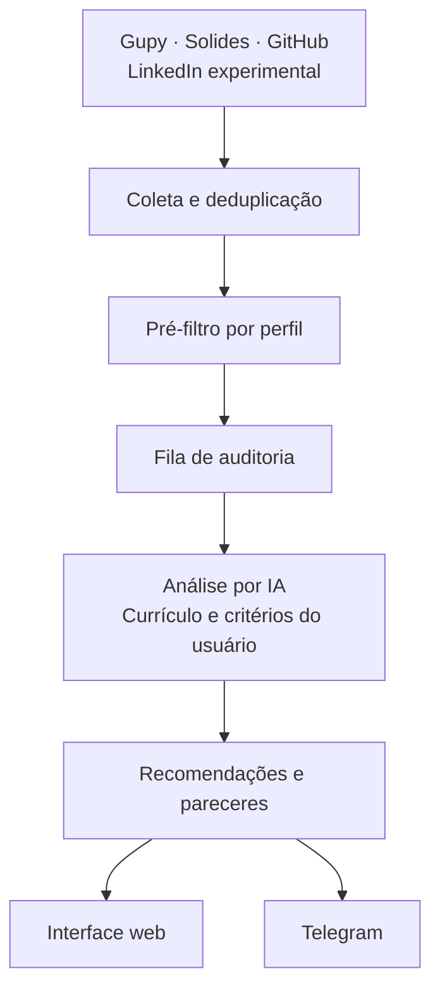

# Job Radar

Encontre vagas de estágio e emprego compatíveis com o seu perfil. O Job Radar reúne anúncios de várias fontes, aplica um pré-filtro, analisa a aderência ao currículo com IA e apresenta as recomendações na interface web e no Telegram.

A candidatura é feita por você: o sistema ajuda na descoberta e na triagem, sem se candidatar automaticamente.

## Teste a plataforma

Acesse **[jobradar-lab.utileasy.com.br](https://jobradar-lab.utileasy.com.br)** com a conta pública de demonstração:

| Campo | Valor |
|---|---|
| E-mail | `usuario_teste@gmail.com` |
| Senha | `usuarioteste01` |

Para explorar o sistema:

1. Consulte **Visão geral** para acompanhar o funil e as recomendações.
2. Abra **Vagas** para ver os anúncios, os pareceres da IA e registrar decisões.
3. Explore **Meu perfil** para conhecer os critérios usados na seleção. Há um [currículo fictício de estágio fullstack](https://github.com/paulocerqr/k8s-lab/blob/main/docs/curriculo-teste.md) disponível para teste.

A conta é compartilhada entre visitantes; alterações podem aparecer para outras pessoas. Use apenas dados fictícios e preserve as credenciais. A demonstração depende da disponibilidade do ambiente do lab; a instalação local usa suas próprias credenciais.

## Funcionalidades

- **Coleta de vagas:** Gupy, Solides e GitHub; LinkedIn via JobSpy em caráter experimental, desativado por padrão.
- **Seleção por perfil:** pré-filtro, fila de análise e auditoria por IA comparando vaga, currículo e critérios do usuário.
- **Providers de IA:** Groq, NVIDIA e Gemini, com prioridades e fallback; integração com Codex CLI exclusiva do administrador.
- **Interface web:** visão geral, vagas e pareceres, decisões, perfil, providers, fontes e histórico de coleta. Administração de usuários por convite.
- **Telegram:** vínculo de conta, recomendações com ações, resumo diário e consulta de status.
- **Operação:** migrations, healthchecks, coleta por scheduler ou CronJobs e deploy em Docker Compose ou Kubernetes.

## Arquitetura



O PostgreSQL persiste usuários, perfis, vagas, análises e decisões. A mesma imagem executa a API, o worker e os comandos de administração. O frontend é exportado como arquivos estáticos e servido pela própria API; Node.js é necessário apenas no build ou no desenvolvimento do frontend.

| Camada | Tecnologias |
|---|---|
| Backend | Python 3.12+, FastAPI, Pydantic e Typer |
| Frontend | Next.js, React e TypeScript |
| Persistência | PostgreSQL, SQLAlchemy e Alembic |
| Agendamento | APScheduler; CronJobs no Kubernetes |
| Empacotamento e CI/CD | Docker, GitHub Actions e GHCR |

No [lab Kubernetes](https://github.com/paulocerqr/k8s-lab), a API possui **duas réplicas**, ambas servindo a Web UI e compartilhando o mesmo PostgreSQL. O worker tem uma réplica. A infraestrutura, o monitoramento e o fluxo de deploy com Argo CD estão documentados no repositório do lab.

## Execução local

Requer Git e Docker com Compose. As configurações disponíveis estão em [`.env.example`](.env.example).

```bash
git clone https://github.com/paulocerqr/job-radar.git
cd job-radar
cp .env.example .env
```

Edite o `.env`: defina `POSTGRES_PASSWORD`, atualize a mesma senha em `DATABASE_URL` e configure `ADMIN_EMAIL`, `ADMIN_NOME` e `ADMIN_SENHA`. As credenciais públicas de demonstração não são criadas automaticamente no ambiente local.

Gere a chave que cifra as credenciais de IA e também pode ser usada para derivar a chave de sessão:

```bash
docker compose build
docker compose run --rm --no-deps api chave-fernet
```

Copie a chave gerada para `FERNET_KEY` no `.env` antes de iniciar os serviços. Para HTTP local, mantenha `SESSAO_COOKIE_SEGURO=false`.

```bash
docker compose up -d
docker compose run --rm api seed

curl http://localhost:8000/healthz
curl http://localhost:8000/readyz
```

Abra **[localhost:8000](http://localhost:8000)** e entre com o administrador definido no `.env`. O Compose inicia PostgreSQL, migrations, API e um worker; o `seed` cadastra as fontes e o administrador de forma idempotente.

Para obter recomendações personalizadas, preencha **Meu perfil** com currículo e critérios e configure ao menos um provider de IA. O token do Telegram é opcional: sem ele, as notificações ficam desligadas. Consulte o [guia de operação](docs/OPERACAO.md) para cadastrar providers, vincular o Telegram e executar coletas.

## Documentação

| Guia | Conteúdo |
|---|---|
| [Operação e configuração](docs/OPERACAO.md) | CLI, providers de IA, currículo, Telegram e particularidades do LinkedIn |
| [Desenvolvimento](docs/DESENVOLVIMENTO.md) | Ambiente Python, testes, migrations e frontend |
| [CI/CD](docs/CI-CD.md) | GitHub Actions, publicação no GHCR e fluxo de PR |
| [Deploy Kubernetes](docs/K8S-LAB.md) | Referência para a infraestrutura do lab |
| [Plano do projeto](docs/PLANO.md) | Requisitos, regras de negócio, modelo de dados e decisões |

## Limitações atuais

- As fontes podem limitar requisições ou retornar anúncios incompletos. A integração experimental com o LinkedIn tem restrições documentadas no [guia de operação](docs/OPERACAO.md#linkedin-via-jobspy-experimental).
- Pareceres da IA auxiliam a triagem; confirme os requisitos e as condições no anúncio original.
- O Telegram usa long polling: mantenha apenas um processo fazendo polling por bot.
- O cadastro de usuários ocorre por convite. A conta pública acima permite avaliar o sistema sem criar uma conta.
